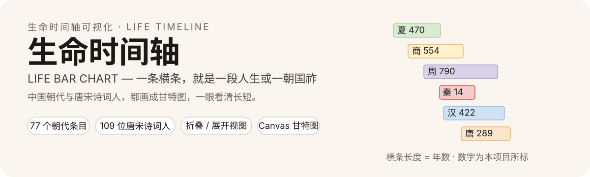
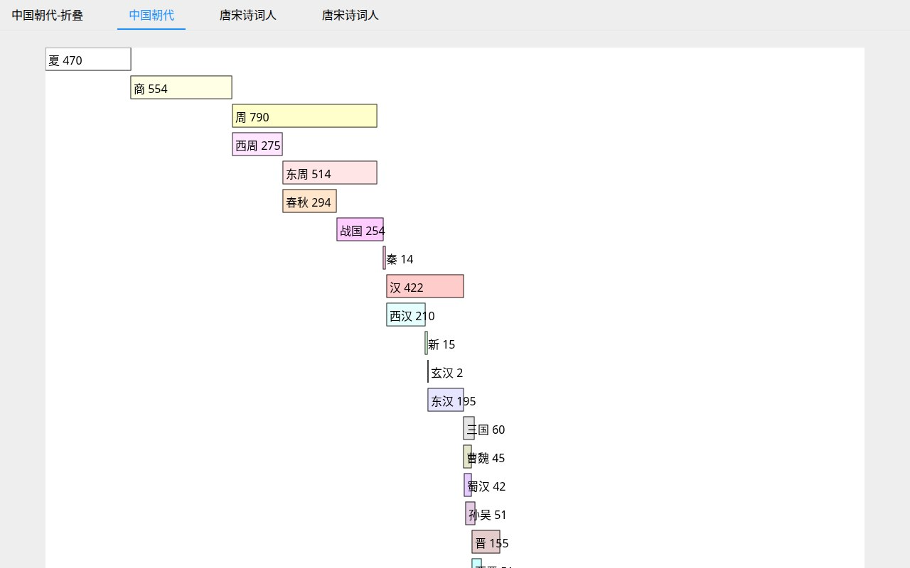
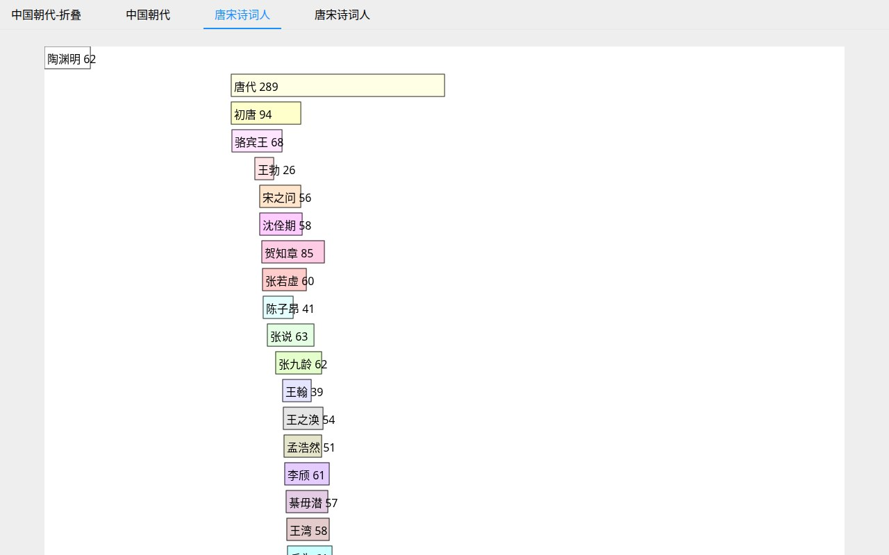

<p align="right"><a href="README.md">中文</a></p>

<p align="center">
  
</p>

<p align="center">
  <a href="https://xiaosang.cc/life-bar-chart/">▶ Live Demo</a>
  ·
  <a href="https://github.com/holynova/life_bar_chart">GitHub Repository</a>
</p>

Life Bar Chart is a React + Canvas timeline visualization: Chinese dynasties and Tang/Song poets drawn as Gantt bars — one bar per dynasty or poet, bar length proportional to years, so you can see at a glance who lasted longest and who lived at the same time.

## Screenshots

<p align="center">
  
</p>

<p align="center">
  
</p>

## Content

4 tabs, 2 datasets:

| Tab | Data | Notes |
|---|---|---|
| 中国朝代-折叠 (Dynasties, folded) | 77 dynasty entries | Contemporary dynasties share a row, for the full picture at a glance |
| 中国朝代 (Dynasties) | 77 dynasty entries | One row each, expanded as a staircase in chronological order |
| 唐宋诗词人 (Tang/Song poets) | 109 records | Expanded view, one person per row |
| 唐宋诗词人 (Tang/Song poets) | 109 records | Folded view (same label as the tab above, folded content) |

- **Dynasty data** (`src/pages/HomePage/components/data.ts`): from the Xia dynasty (~2100 BCE) to the Qing, including sub-periods such as Western/Eastern Zhou, Spring and Autumn / Warring States, Three Kingdoms, Northern and Southern dynasties, and Five Dynasties and Ten Kingdoms; each entry is labeled with its start/end years and duration — e.g. Zhou 790 years, Han 422 years, Qin 14 years.
- **Poet data** (`src/data/poet.ts`): 109 Tang/Song poets, including Li Bai (701–762), Du Fu, Su Shi, Bai Juyi, Wang Wei, Li Qingzhao, and Xin Qiji, plus dynasty marker rows (Tang, Early Tang, High Tang, Song, Northern Song, …) as time references.

## Rendering

- Canvas-drawn Gantt bars: 32px rows, 1024px canvas; bar positions are scaled from start/end years across the full time range.
- The folded view compresses time-overlapping entries onto the same row; the expanded view gives each entry its own row.
- Bar colors come from a built-in palette (`colorList1` / `colorList2` in `constants.ts`).

## Run Locally

A Create React App project (React 17 + react-scripts 4), requiring Node.js ≥ 12 and pnpm ≥ 6:

```bash
pnpm install
pnpm start    # dev server, http://localhost:3000
pnpm build    # production build, output in build/
pnpm test     # unit tests
pnpm format   # Prettier formatting
```

## Tech

- React 17 + TypeScript 4.2 + Create React App (react-scripts 4.0.3), Canvas drawing, zero charting libraries.
- The core lives in `src/pages/HomePage/components/`: `LifeBar.ts` converts start/end years into bar coordinates (folded and expanded layouts), `LifeBarChart.tsx` handles Canvas drawing, and `data.ts` / `src/data/poet.ts` hold the two datasets.

```
src/pages/HomePage/HomePage.tsx          4 tabs
src/pages/HomePage/components/
  LifeBar.ts                             years → bar coordinates (folded/expanded)
  LifeBarChart.tsx                       Canvas drawing
  data.ts                                77 dynasty entries
  constants.ts                           color palette
src/data/poet.ts                         109 poet records
src/data/dynasty.ts                      dynasty data (backup)
```
