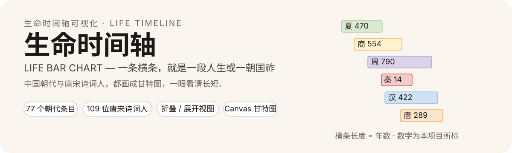
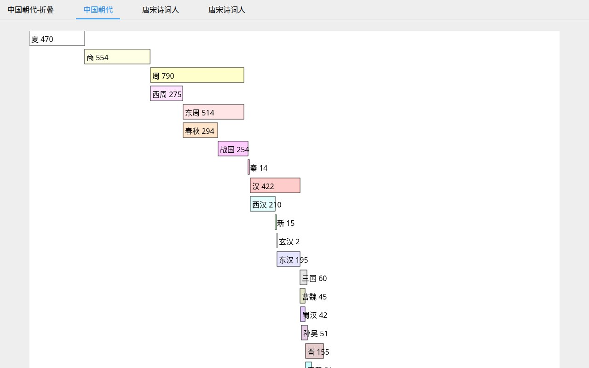
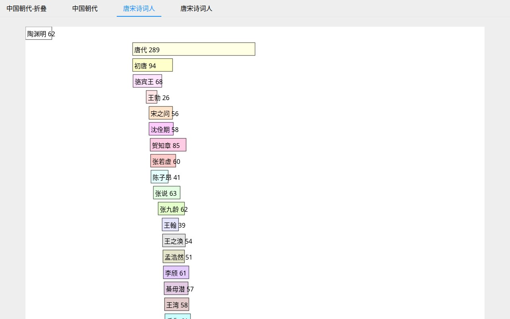

<p align="center">
  
</p>

<p align="center">
  <a href="https://xiaosang.cc/life-bar-chart/">▶ 在线体验 Live Demo</a>
  ·
  <a href="https://github.com/holynova/life_bar_chart">GitHub 仓库</a>
</p>

生命时间轴是基于 React 和 Canvas 的生命时间轴可视化工具，把中国朝代与唐宋诗词人的存续时间画成甘特图：一条横条就是一个朝代或一位诗人，横条长度即年数，一眼看清谁长谁短、谁与谁同代。

Life Bar Chart is a React + Canvas timeline visualization: Chinese dynasties and Tang/Song poets drawn as Gantt bars — one bar per dynasty or poet, bar length proportional to years, so you can see at a glance who lasted longest and who lived at the same time.

## 截图 / Screenshots

<p align="center">
  
</p>

<p align="center">
  
</p>

## 内容 / Content

4 个标签页，2 份数据：

| 标签页 | 数据 | 说明 |
|---|---|---|
| 中国朝代-折叠 | 77 个朝代条目 | 同时期的朝代折叠到同一行，纵览全局 |
| 中国朝代 | 77 个朝代条目 | 每条一行，按时间先后阶梯展开 |
| 唐宋诗词人 | 109 条记录 | 展开视图，一人一行 |
| 唐宋诗词人 | 109 条记录 | 折叠视图（与上一个标签同名，内容为折叠版） |

- **朝代数据**（`src/pages/HomePage/components/data.ts`）：从夏朝（前 2100 年）到清朝，含西周 / 东周、春秋 / 战国、三国、南北朝、五代十国等子时期；每条标注起止年份与年数，如周 790 年、汉 422 年、秦 14 年。
- **诗词人数据**（`src/data/poet.ts`）：唐宋诗词人 109 条，含李白（701–762）、杜甫、苏轼、白居易、王维、李清照、辛弃疾等，另有唐代 / 初唐 / 盛唐 / 宋代 / 北宋等朝代标记行作时间参照。

## 渲染 / Rendering

- Canvas 绘制甘特横条：行高 32px，画布宽 1024，横条位置按起止年份在全局时间范围内的比例换算。
- 折叠视图把时间重叠的条目压到同一行；展开视图每条独占一行。
- 条目颜色来自内置色板（`constants.ts` 的 `colorList1` / `colorList2`）。

## 本地运行 / Run Locally

Create React App 项目（React 17 + react-scripts 4），环境要求 Node.js ≥ 12、pnpm ≥ 6：

```bash
pnpm install
pnpm start    # 开发服务，http://localhost:3000
pnpm build    # 生产构建，产物在 build/
pnpm test     # 单元测试
pnpm format   # Prettier 格式化
```

## 技术 / Tech

- React 17 + TypeScript 4.2 + Create React App（react-scripts 4.0.3），Canvas 绘图，零图表库。
- 核心在 `src/pages/HomePage/components/`：`LifeBar.ts` 把起止年份换算成横条坐标（折叠 / 展开两种布局），`LifeBarChart.tsx` 负责 Canvas 绘制，`data.ts` / `src/data/poet.ts` 是两份数据。

```
src/pages/HomePage/HomePage.tsx          4 个标签页
src/pages/HomePage/components/
  LifeBar.ts                             年份 → 横条坐标换算（折叠/展开）
  LifeBarChart.tsx                       Canvas 绘制
  data.ts                                77 个朝代条目
  constants.ts                           色板
src/data/poet.ts                         109 条诗词人记录
src/data/dynasty.ts                      朝代数据（备用）
```

## English

**Life Bar Chart** visualizes lifetimes as Gantt bars on a Canvas: Chinese dynasties and Tang/Song poets, one bar each, length proportional to years.

- **4 tabs, 2 datasets**: 77 dynasty entries from Xia (~2100 BCE) to Qing, in folded (contemporary dynasties share rows) and expanded (one row each) views; 109 Tang/Song poet records (Li Bai, Du Fu, Su Shi, Bai Juyi, Li Qingzhao, Xin Qiji, …) plus dynasty marker rows (Tang, Early Tang, Song, …) as time references, also in folded and expanded views. Note the two poet tabs share the same label.
- **Rendering**: Canvas-drawn bars, 32px rows, 1024px canvas; bar positions are scaled from start/end years across the full time range.
- **Run it**: `pnpm install && pnpm start` (`http://localhost:3000`); build with `pnpm build`. **Tech**: React 17 + TypeScript 4.2 + Create React App, zero charting libraries.

## 许可 / License

MIT，见原 README 声明（仓库暂无 LICENSE 文件）。
